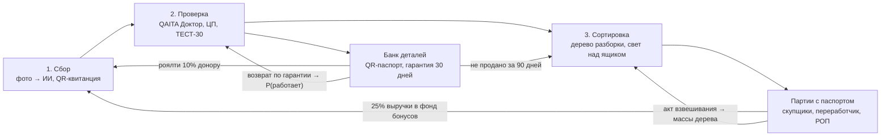

# QAITA — «Собери. Спроси. Спаси.» (Hack.IT, STEM, кейс «Электронные отходы»)

QAITA — городская система для Актобе. Она забирает старую технику там, где та уже лежит, за секунды узнаёт,
что в ней живо, и даёт ей вторую жизнь: целиком, на детали или в переработку. «Қайта» по-казахски — «снова, заново».

Кейс просит сделать эффективнее сбор, проверку, сортировку или повторное использование.
QAITA закрывает все этапы, поэтому этот репозиторий — про всю систему, а не только про приложение.

| Этап | Слоган | Что делаем | Где в репозитории |
| --- | --- | --- | --- |
| 1. Сбор | Собери · *Жина* | Приложение жителя: фото → ИИ в телефоне, куда сдать, QR-квитанция, бонусы. 40 школ Донор-лиги, 5 боксов, «Бирка у бака», «Обратный рейс» | приложение: `src/`, сайт — `docs/` |
| **2. Проверка** | **Спроси · *Сұра*** | **Устройство само рассказывает о себе. Человек проверяет только то, что окупится** | **`check/` и экран «Хаб»** |
| **3. Сортировка и вторая жизнь** | **Спаси · *Сақта*** | **Дерево разборки решает в тенге, насколько разбирать вещь и в какой ящик класть каждую часть. Свет над ящиком, батарея — только в шкаф, партии с паспортом. Детали — под заказ мастерских** | **`sort/` и экран «Хаб» → «Сортировочная стена»** |

## Как связаны этапы: один QR-паспорт на всю жизнь вещи

Вещь получает номер на QR-квитанции у жителя. Дальше каждый этап дописывает в её паспорт то, что узнал, и следующий этап решает по этим данным, а не на глаз.



| Откуда → куда | Что передаём | Что это решает |
| --- | --- | --- |
| Сбор → Проверка | вид техники и состояние (ИИ в телефоне и ответ жителя), номер, школа или бокс | план проверки: какую ступень лестницы задать первой |
| Проверка → Сортировка | паспорт Доктора (модель, батарея, SMART, распаяна ли память), снятые детали, сделанные шаги | дерево не предлагает снять то, что уже снято или распаяно, и не платит второй раз за вскрытый корпус |
| Сортировка → деньги | партии с паспортом: вес, устройства, батареи, категория РОП | продаём по сорту, а не «лом микс»; акт для выплаты РОП готов |
| Деньги → Сбор | роялти 10% с проданных деталей, 25% выручки в фонд бонусов | житель видит, что его вещь спасла, и приносит следующую |
| Обратные связи | возвраты по гарантии, акты взвешивания, новые прайсы | пороги проверки, массы и цены в дереве уточняются сами |

**Одна логика на весь хаб: каждое действие — решение в тенге.** Снять деталь — если EV больше нуля. Проверить — если ценность проверки больше её цены.
Вскрыть корпус — если ценность частей больше цены вещи целиком плюс минуты работы. Безопасность и данные — вне экономики, всегда.

---

## Этап 2. Проверка — «Спроси»

### Задача кейса

Полная проверка устройства стоит 3 000 ₸, а годные детали — около 2 000 ₸, и они есть только в 60% устройств:
0,6 × 2 000 − 3 000 = **−1 800 ₸ на каждом проверенном устройстве**.
Ячейку аккумулятора руками проверяют 15 минут за 900 ₸ — дороже новой 18650 на Kaspi (от 375 ₸).
Если проверять всё подряд, каждая вещь приносит убыток.

### Решение в одной фразе

> **Каждая проверка — это вопрос. Сначала задаём его самому устройству, а человеку — только если ответ окупится.**

Три принципа. Они работают для любой вещи — от телефона до чайника:

1. **Спроси само устройство.** Ноутбук годами ведёт «медкарту» батареи: газомер считает каждый кулон (Q = ∫ I dt)
   и знает реальную ёмкость, циклы и напряжение каждой группы ячеек. SSD ведёт журнал здоровья SMART.
   Телефон показывает экран, касание, камеры и зарядку прямо с экрана блокировки — без пароля и без доступа к данным.
   **Замер 18.11 на ноутбуке команды: чип батареи прочитан за 0,015 с.** Проверить те же 3 ячейки руками — 45 мин и 2 700 ₸.
2. **Спрашивай, только если ответ окупится.** Проверка нужна, только если её ответ может изменить решение:
   снять деталь или оставить, вскрыть батарею или сдать целиком. Это ценность информации из теории решений,
   мы считаем её в тенге (формула ниже). Безопасность и данные — вне экономики: осмотр на вздутие и стирание — всегда.
3. **Каждый ответ учит систему.** Всё, что узнали, записываем в QR-паспорт детали. Деталь продаётся с гарантией 30 дней,
   и гарантия работает как датчик: каждый возврат — это ошибка нашей проверки. После каждой продажи
   P(работает | прошла проверку) пересчитывается по Байесу, а порог, который ошибается чаще 3%, ужесточается.

### Ценность проверки (ЦП) — главная формула этапа

По документации деталь снимаем, если EV = P(работает) × цена × P(купят) − t × 60 ₸ больше нуля.
Проверка до снятия может спасти только от двух ошибок:
- снять нерабочую деталь — теряем (1 − P) × K;
- оставить рабочую — теряем P × (V − K).

Здесь V = цена × P(купят), K = t<sub>мин</sub> × 60 ₸. Без проверки мы и так выбираем меньшую из двух ошибок, поэтому

**ЦП = min((1 − P) × K, P × (V − K))**, а если V ≤ K, то ЦП = 0.

Проверку до снятия делаем, только если ЦП больше её цены. Формула совпадает с прямым расчётом
«идеальная проверка минус лучшее решение без неё» (тест на 304 комбинациях P, V и K).

| Деталь (числа из документации) | EV | ЦП | Что делаем |
| --- | --- | --- | --- |
| Экран Samsung A50, есть заявка: P 0,7 · 4 000 ₸ · 6 мин | +2 160 ₸ | 108 ₸ | Снимаем по заявке. A50 не включается — до снятия не проверить, снятый экран проверяем для паспорта |
| Камера A50 без заявки: P 0,8 · 900 ₸ · 3 мин | −36 ₸ | 0 ₸ | Не проверяем и не снимаем: даже рабочая не окупается (900 × 0,2 = 180 ₸ — ровно 3 минуты работы) |
| Память Lenovo: P 0,9 · 4 000 ₸ · 1 мин | +3 180 ₸ | 6 ₸ | Снять за минуту дешевле, чем проверять отдельно |
| SSD Lenovo: P 0,85 · 6 000 ₸ · 2 мин | +4 470 ₸ | 18 ₸ | То же |
| 3 ячейки Lenovo: P 0,8 · 3 × 400 ₸ · 6 мин | +504 ₸ | 72 ₸ | Чип батареи до вскрытия стоит 30 ₸ — окупается |
| Nokia 105, чайник «не греет», кабели | — | 0 ₸ | Спроса на детали нет, проверка ничего не изменит: сразу «Сырьё», 0 ₸ на проверку |

**Пакет батареи: вскрывать вслепую или сначала спросить чип?**
Годных пакетов (здоровье не ниже 60%) — около половины: это наша оценка, в исследовании IBM UrJar годны 70% выброшенных батарей ноутбуков.
- Вслепую: 0,5 × 0,8 × 1 080 − 360 = **+72 ₸** на пакет.
- С чипом: негодный пакет не вскрываем, годный даёт 0,8 × 1 080 − 360 = +504 ₸ → 0,5 × 504 − 30 = **+222 ₸**.
- ЦП чипа — **180 ₸** при цене чтения 30 ₸. Чип утраивает ценность пакета, поэтому читаем его всегда.

**QAITA Доктор отвечает сразу за всё.** У Lenovo ЦП памяти, SSD и батареи вместе — 6 + 18 + 180 = **204 ₸**
против 60 ₸ за минуту работы → запускаем.

### Лестница проверки

| Ступень | Кто отвечает | Время человека | Что узнаём |
| --- | --- | --- | --- |
| 0. До сдачи | житель в приложении: фото → ИИ в телефоне, «включается?», выход из iCloud или Google | 0 | вид техники и состояние → первая оценка P(работает) |
| 1. Приём | техник: вес, фото, QR-этикетка, осмотр | 0,5 мин (внутри 45 с триажа) | опасно или нет: вздутое — сразу в шкаф с песком |
| 2. Спроси устройство | само устройство: чип батареи, SMART, экран блокировки | ≈ 1 мин | здоровье и циклы батареи, напряжения групп, износ диска, живы ли экран, касание, камеры |
| 3. Электрический тест | стенд ТЕСТ-30, лабораторный блок питания, розетка с УЗО | 10 с на ячейку, 1–4 мин на устройство | сопротивление и нагрев ячейки, жива ли плата |
| 4. Полный цикл | Lii-500 и 7 дней на полке | 20 с на ячейку | точная ёмкость — только у спорных ячеек; саморазряд |

Чем выше ступень, тем дороже вопрос и тем меньше вещей до неё доходит.

### Матрица: как проверяем любую вещь

| Вещь | Включается | Включается, но заблокирована | Не включается | Опасно |
| --- | --- | --- | --- | --- |
| Ноутбук, ПК, моноблок | QAITA Доктор одной командой: батарея, SMART, память — паспорт за ≈ 1 мин | загрузочная флешка QAITA Доктора: пароль Windows не мешает. Mac с блокировкой активации — только детали | пакет — ридер чипа на ESP32 (SMBus, 3 провода); SSD и память — в ноутбуке станции приёма | вздутая батарея → шкаф с песком |
| Телефон, планшет | экран блокировки: экран, касание (клавиатура экстренного вызова), обе камеры, вспышка, зарядка — 1 мин | то же. Сброс через режим восстановления — это и есть криптостирание; если экран активации просит чужой iCloud или Google — только детали | 10 мин на зарядке; не ожил — ток платы от лабораторного блока питания покажет «мертва», «замыкание» или «жива» (только у ценных моделей) | вздутие → шкаф |
| Пауэрбанк, ячейки 18650 | ТЕСТ-30: 16 ячеек за 30 с | — | ТЕСТ-30: ниже 2,5 В → C | нагрев больше 2 °C → C |
| Монитор, телевизор | тест-картинка: битые пиксели, подсветка — 1 мин | — | ремонт плат не окупается → «Сырьё» | разбитая матрица — отдельно |
| Мелкая бытовая, роутер | розетка с УЗО, 1 мин — только если на целую вещь есть спрос | — | «Сырьё» без проверки (ЦП = 0) | протечка, обгорание → «Опасно» |
| Зарядки, кабели | не проверяем: медь и пластик (ЦП = 0) | — | — | — |
| Холодильник, стиральная машина | в хаб не едут: партнёр откачивает фреон и выдаёт акт с весом, рабочую технику отдают семье через акимат | — | — | — |

Каждая вещь в хабе получает понятный путь: ничего не проверяем «на всякий случай» и ничего опасного не пропускаем.

### QAITA Доктор: «спроси устройство» одной командой

Скрипты лежат в `check/doctor`, подробности — в [check/README.md](check/README.md).

| Система | Команда | Что читает |
| --- | --- | --- |
| macOS | `sh qaita-doctor.sh` | газомер батареи (ioreg): ёмкость, циклы, напряжение и химическую ёмкость (Qmax) каждой группы, историю температур, аварийный флаг; SSD и SMART, память, процессор, блокировку активации |
| Linux и загрузочная флешка | `sh qaita-doctor.sh` | батарею из `/sys/class/power_supply`, модель из DMI, SMART, износ и часы работы диска (smartctl) |
| Windows 10 и 11 | `powershell -ExecutionPolicy Bypass -File qaita-doctor.ps1` | батарею из WMI (запасной путь — `powercfg /batteryreport /xml`), здоровье дисков, память, процессор |

Скрипт печатает паспорт и открывает его в хабе ссылкой `…#hub/doctor=…`: в очереди появляется карточка устройства.
Без интернета — параметр `--app qaita.html` (офлайн-файл) или вставить ссылку в «Спроси устройство».
- **Только железо.** Файлы, имя пользователя и компьютера не читаем, серийный номер — последние 4 знака. Ничего не стираем и не меняем.
- **Пароль не мешает.** Запароленный ноутбук загружаем с флешки: live-Linux со smartmontools и нашим скриптом.
  Если BIOS не даёт загрузиться с флешки, устройство идёт путём «не включается».
- **Ноутбук не включается.** Пакет батареи читает ESP32 по SMBus — стандарт Smart Battery Data Specification
  (0x10 FullChargeCapacity, 0x17 CycleCount, 0x18 DesignCapacity), так работает открытый проект PackProbe.
  SSD и память проверяем в ноутбуке станции приёма.
- **Проверено 19.11.** На MacBook команды скрипт прочитал чип bq40z651: здоровье 88%, 238 циклов, напряжения трёх групп,
  SSD в норме, блокировка активации включена — такой Mac целым не продаём. Весь паспорт — за 0,4–3 с.
  Linux-версия проверена на тестовых данных ThinkPad T480 (`tests/fixtures/doctor-linux`).
  Windows-версию нужно запустить на ноутбуке команды до записи видео.

### ТЕСТ-30: что он меряет, а что нет

**За 30 секунд ёмкость не измерить** — для этого нужен полный разряд с подсчётом мА·ч, а это часы.
Импульс честно меряет сопротивление, напряжение и нагрев. Поэтому:
1. **Ёмкость ячейка наследует от чипа своего пакета** — газомер мерил её годами. Это оценка снизу: пакет ограничен самой слабой группой.
2. **Импульс ищет выбивающуюся ячейку.** Соседи по пакету старели вместе, поэтому сравниваем ячейку с ними.
   Если её R выше медианы соседей больше чем в 1,3 раза, у ячейки своя беда — ёмкость она не наследует.
3. **Спорные ячейки — на полный цикл Lii-500:** выбивающиеся и ячейки без чипа (пауэрбанки, россыпь).
   Правило качества: **ни одна ячейка не получает A или B без измеренной ёмкости** — чипом за годы или Lii-500 за 8 часов.

Протокол стенда — 30 с на 16 ячеек сразу:

| Время | Что делает стенд | Что получаем |
| --- | --- | --- |
| 0–4 с | покой | U покоя; ниже 2,5 В → C: глубоко разряженную ячейку заряжать опасно |
| 4 с | импульс через резистор 2 Ом / 10 Вт, ≈ 1,85 А | — |
| 5 с | U через 1 с импульса | R = (U покоя − U через 1 с) / I — по двум точкам, как метод DC в IEC 61960 |
| 4–24 с | импульс 20 с, термодатчик NTC | нагрев больше 2 °C → C (внутреннее замыкание) |
| 24–30 с | восстановление | поляризация — признак роста слоя SEI |

Точность:
- **Провода и контакты.** Стенд подключён двумя проводами, а провода и пружины держателя добавляют 20–30 мОм — это сравнимо с самим порогом A (80 мОм).
  Каждое утро эталонная ячейка проходит все 16 слотов: разница её показаний — поправка слота, её вычитаем. Эталон контролируем тестером YR1035+.
- **Шаг INA219** — 4 мВ: при токе 1,85 А это 2,2 мОм. На каждую точку берём среднее нескольких замеров.
- **Рядом с порогом.** Если R ближе 10 мОм к порогу 80 или 150 мОм, ячейку переставляем и меряем ещё раз.
- **Саморазряд.** Ячейки A и B лежат 7 дней при 30–50% заряда: просадка больше 0,05 В → C.
  Ячейки B идут в детские наборы робототехники, поэтому правило для них то же.

Грейды — из документации: A — здоровье ≥ 80% и R ≤ 80 мОм; B — 65–80% и R ≤ 150 мОм;
C — хуже, U < 2,5 В или нагрев больше 2 °C. Новое — **«спорная»**: ёмкость неизвестна → полный цикл, потом A, B или C.

### Цифры этапа

Все числа считает `node check/model/check-model.mjs`, а `npm run check-stage` сверяет их с этим README.

| | По кейсу (руками) | QAITA |
| --- | --- | --- |
| Ячейка | 15 мин и 900 ₸ | 10 с рук и 30 с стенда — **37,6 ₸** (в документации ≈ 38 ₸). С повторным замером через 7 дней и полным циклом спорных — **42 ₸**, в 21,4 раза дешевле |
| 5 610 ячеек пилота | **1 402,5 ч** и **5 049 000 ₸** | **22,4 ч** рук и ≈ 236 000 ₸ |
| 3 ячейки ноутбука команды | 45 мин и 2 700 ₸ | чип: 0,015 с машины и 30 с человека — в 90 раз дешевле |
| Пакет батареи | вскрывать каждый | плохой пакет не вскрываем: +72 ₸ → +222 ₸ на пакет |
| Устройство в хабе | 3 000 ₸ | 206 ₸ — весь путь в хабе (документация); повторный замер и полный цикл спорных добавляют 1,2 ₸ |

Мощность:
- **Стенд.** Пачка 16 ячеек — 160 с рук и 30 с теста, всего 190 с: стенд проверяет 303 ячейки в час.
  Все 5 610 ячеек пилота — 18,5 ч работы стенда.
- **Lii-500.** 2 анализатора × 4 слота, цикл ≈ 8 ч и только в рабочее время (зарядка без людей запрещена):
  8 ячеек в день × ≈ 100 рабочих дней = **800 полных циклов**. Хватает, если спорных не больше **14,3%**.
  Цель — 10% (561 ячейка, загрузка 70%). Если спорных больше — третий Lii-500 из резерва (10 099 ₸).

Как меряем этап в пилоте:

| Показатель | Цель | Откуда цифра |
| --- | --- | --- |
| Время человека на устройство | не больше, чем в модели (206 ₸) | таймер операций в панели хаба |
| Спорные ячейки | ≤ 10% | журнал стенда ТЕСТ-30 |
| Возвраты по гарантии | ≤ 3% | банк деталей: каждый возврат — с номером проверки |
| Носители с сертификатом стирания или уничтожения | 100% | сертификаты в приложении |
| Возгорания | 0 | журнал хаба |

### Оборудование — уже в бюджете

Этап 2 не требует ни тенге сверх 10 000 000 ₸. Всё — в строках бюджета документации:
- **«Диагностика и ТЕСТ-30» — 166 884 ₸:** 2 ESP32-S3 (стенд и ридер чипа батареи), 16 INA219, 2 мультиплексора TCA9548A,
  16 MOSFET-ключей, 16 держателей, 16 резисторов 2 Ом / 10 Вт, 16 термодатчиков NTC, лабораторный блок питания 30 В / 10 А,
  2 анализатора Lii-500, тестер YR1035+, 4 флешки QAITA Доктора.
- **«Рабочие места»:** ноутбук станции приёма (он же проверяет снятые память и SSD), док-станции USB-SATA, мультиметр,
  принтер QR-этикеток, наборы для вскрытия.
- **«Склад и безопасность»:** металлический шкаф с песком, огнетушители. Розетка с УЗО для бытовой техники — в строке «Подготовка: розетки…».

### Данные — всегда, вне экономики

- SSD — NVMe Sanitize или ATA Secure Erase с проверкой, HDD — перезапись, неисправный носитель — физическое уничтожение
  (NIST SP 800-88: Purge и Destroy).
- Телефон — сброс уничтожает ключ шифрования, это криптостирание. Плату, которую не удалось сбросить, уничтожаем;
  продаём только экран, камеры и корпус.
- Донор получает сертификат в приложении — уже работает.

### Что здесь нового

| Кто | Как проверяет | Чего не хватает |
| --- | --- | --- |
| Ручная проверка (кейс) | человек проверяет всё подряд: 3 000 ₸ на устройство, 15 мин на ячейку | дороже самих деталей |
| ecoATM, trade-in в Technodom и Sulpak | фото и IMEI | только телефоны и только целые |
| Мастерские, PackProbe | читают чип батареи | это инструмент, а не система: нет решения «проверять или нет» |
| Анализаторы ячеек | меряют каждую ячейку часами | не знают ни чипа пакета, ни соседей — долго |
| **QAITA** | **устройство отвечает само → человек проверяет, только если ЦП больше цены проверки → гарантия учит пороги** | — |

По отдельности всё это известно: газомер, SMART, импульсный замер R, ценность информации.
Новое — связка: проверка становится экономическим решением для каждой вещи и каждой детали, в тенге, на данных самого устройства.

### Что уже работает в прототипе

| Часть | Статус |
| --- | --- |
| QAITA Доктор для macOS и Linux | настоящий: проверен на MacBook команды и на тестовых данных Linux |
| QAITA Доктор для Windows | настоящий скрипт; запустить на ноутбуке с Windows до записи видео |
| Паспорт по ссылке в хабе: карточка, батарея, группы ячеек, SMART, блокировка активации | настоящее чтение |
| План проверки для любой вещи — лестница и матрица | настоящий выбор по виду техники и состоянию |
| ЦП в таблице деталей, «вслепую или с чипом», QAITA Доктор для всего ноутбука | настоящий расчёт по формуле |
| ТЕСТ-30 | симуляция по физической модели: сопротивление, нагрев, поправки слотов, соседи по пакету, спорные — на Lii-500 |
| Ридер чипа на ESP32, загрузочная флешка, гарантия как датчик | в пилоте; описано здесь и в `check/README.md` |

### На защите — 40 секунд про проверку

1. «Проверка стоит 3 000 ₸, детали — 2 000. Значит, проверять должен не человек».
2. Запускаем QAITA Доктор на ноутбуке у сцены: чип батареи отвечает за доли секунды, паспорт сразу в хабе.
3. «Мы проверяем, только если ответ окупится»: камера A50 без заявки — ЦП 0 ₸, не трогаем; чип батареи — 30 ₸ и +150 ₸ к ценности пакета.
4. «Стенд за 30 секунд не меряет ёмкость — её отдаёт чип. Спорные ячейки — на полный цикл. Без измеренной ёмкости A не бывает».

### Вопросы жюри по проверке

1. **Как стенд за 30 секунд узнаёт ёмкость?** Никак, и мы это не скрываем. Импульс меряет сопротивление, напряжение и нагрев.
   Ёмкость ячейка берёт из чипа своего пакета, который мерил её годами. Выбивающиеся ячейки и ячейки без чипа идут на полный цикл.
2. **Ноутбук запаролен?** Загружаем его с флешки QAITA Доктора: пароль Windows не мешает читать железо.
3. **Не включается?** Батарею читает ESP32 по SMBus, память и SSD проверяет ноутбук станции приёма, плату — ток от лабораторного блока питания.
4. **А телефоны?** С экрана блокировки проверяются экран, касание, камеры, вспышка и зарядка — без пароля и без доступа к данным.
5. **Почему не проверять всё?** Проверка, которая не может изменить решение, — выброшенные деньги.
   Камеру A50 без заявки не снимаем, даже рабочую: 900 × 0,2 = 180 ₸ — ровно 3 минуты работы.
6. **Насколько это точно?** Каждое утро поправки слотов по эталону, повтор у порога, полный цикл спорных, 7 дней саморазряда, гарантия 30 дней.
   Возвраты пересчитывают P(работает) и пороги.
7. **Почему не ИИ по фото?** ИИ видит корпус, а не химию батареи. Он работает на ступени 0 — узнаёт вид техники.
   О здоровье отвечает электроника самого устройства.
8. **Безопасно ли?** Вздутые батареи сразу идут в металлический шкаф с песком. За 20 с импульса исправная ячейка нагревается
   на десятые доли градуса, поэтому +2 °C — признак замыкания. Заряжаем только при людях.
9. **Сколько стоит этап?** 166 884 ₸ оборудования — уже в бюджете. Ячейка — 37,6 ₸ на стенде и 42 ₸ до продажи вместо 900 ₸.

---

## Этап 3. Сортировка — «Спаси»

### Задача кейса

Кейс просит сделать эффективнее сортировку и повторное использование. Разборка ноутбука по кейсу — 25–30 минут, это 1 500–1 800 ₸ работы.
А скупщики в Казахстане платят по сорту, и разница огромная (13 прайсов OLX за 4–19.11.2026, медианы):
- оперативная память — **24 000 ₸/кг**, а ноутбук целиком у переработчика (модель команды) — 250 ₸/кг: в **96 раз** дешевле;
- плата телефона — **11 000 ₸/кг**, телефон целиком — 600 ₸/кг: в **18 раз** дешевле;
- шнур — **900 ₸/кг** как медный кабель, а чайник со шнуром — 60 ₸/кг.

Не сортировать — значит продавать всё по самой низкой цене. Разбирать всё — значит работать в убыток.
Ещё два риска. Батарея, забытая в ломе, — главная причина пожаров на объектах отходов: в Великобритании это **48%** пожаров (Eunomia, 2019–2020), а полигон Актобе горит годами.
Шредер теряет золото: в фракции, из которых его можно извлечь, доходит только **25,6%** золота и палладия (Chancerel и др., 2009). Платы надо снимать руками до любой дробилки.

### Решение в одной фразе

> **Сортирует расчёт, а не опыт. Каждую вещь разбираем ровно до того шага, который ещё окупается, и каждую часть отдаём тому, кто заплатит больше. Свет над ящиком показывает технику, куда её положить.**

Три принципа:

1. **Разбирай, пока окупается.** У каждого вида техники есть дерево разборки. Для каждого узла сравниваем два варианта:
   продать его целиком или вскрыть, заплатив минутами работы, и продать части по их ценам. Цены скупщиков меняются — меняется и глубина разборки.
2. **Сортирует паспорт, а не человек.** Паспорт вещи с этапов 1–2 знает модель, батарею, распаянную память и детали, снятые под заказ.
   Поэтому план разборки готов до того, как техник взял вещь в руки. Техник сканирует QR — над нужными ящиками загорается свет.
   Батарея физически не попадает в ящики скупщиков: после вскрытия она идёт только в шкаф с песком.
3. **Партия с паспортом.** Ящик копит партию для своего покупателя. Паспорт партии: вес, устройства, батареи, категория РОП.
   Партию продаём по сорту, а не как «лом микс». Акты взвешивания уточняют массы в дереве — так же, как гарантия уточняет проверку на этапе 2.

### Цены ящиков — с прайсов скупщиков

Все прайсы — объявления на OLX.kz с номерами, их список и расчёт медиан — в `sort/model/sort-model.mjs`. Платы — 5 прайсов сети «Приём плат и микросхем»
(Астана, Петропавловск, Семей, Щучинск, Павлодар): цена за 1 кг, плата без железа и алюминиевых радиаторов. Металл — 2 прайса Актобе и 2 прайса Уральска.

| Ящик | ₸ за кг (медиана) | Разброс прайсов | Покупатель |
| --- | --- | --- | --- |
| ОЗУ | 24 000 | 17 500–26 500 | скупщик плат |
| Платы телефонов | 11 000 | 10 000–13 000 | скупщик плат |
| Платы ноутбуков и SSD | 3 000 | 2 200–4 000; «с жёлтым флажком» — до 5 500 | скупщик плат |
| Телефоны без батареи и задней крышки | 1 500 | 1 000–2 000 | скупщик плат |
| Провода и шнуры | 900 | нижние границы «медного кабеля»: 800–1 000 | приём цветмета |
| Алюминий | 610 | 600–740 (Актобе, Уральск) | приём металла |
| Бытовые платы | 400 | 400–550 | скупщик плат |
| Моторы и ТЭНы | 250 | «электродвигатели от 250» | приём металла |
| Чёрный металл | 45 | 40–45 (Актобе, Уральск) | приём металла |
| Остаток: пластик, матрицы | 0 | — | лицензированный переработчик, выплата РОП — цепочке |
| Целиком переработчику | 600 / 250 / 40 / 60 / 250 | телефоны / ноутбуки / экраны / мелкая бытовая / кабели | модель команды («Сырьё: что и почём») |
| Аккумуляторы | 0 | вывоз Li-ion — 150 000 ₸ за пилот, уже в бюджете | лицензированный переработчик Li-ion |

Продаём только тем, кто в госреестре (уведомление по ст. 337 Экокодекса), а Li-ion — только лицензированному переработчику. Каждая отгрузка — с актом взвешивания.

### Дерево разборки — главная формула этапа

Для каждого узла дерева считаем снизу вверх:

**V(узел) = max( m × цена ящика,  Σ V(частей) − t × 60 ₸ )**

Здесь m — масса узла, t — минуты на вскрытие, 60 ₸ в минуту — ставка из кейса.
- Если корпус вскрыт, каждую часть либо снимаем (её V минус минуты на снятие), либо оставляем внутри, и она продаётся вместе с корпусом.
- Батарея после вскрытия снимается всегда — это безопасность, вне экономики.
- Что сняли на этапе 2, в дереве уже нет. Вскрытие, которое этап 2 уже сделал, второй раз не оплачиваем.

Это динамическое программирование. `npm run sort-stage` сверяет его с перебором всех вариантов разборки на 1 440 наборах цен, ставок и деталей этапа 2: ответ один и тот же.

**Ноутбук Lenovo IdeaPad, 2,2 кг** — как работает формула:

| Шаг | Время | Решение |
| --- | --- | --- |
| Снять нижнюю крышку | 1 мин | вскрываем: дальше есть ценное |
| Батарея → шкаф с песком | 0,5 мин | всегда |
| ОЗУ → скупщику плат | 15 с | +175 ₸: 8 г × 24 000 ₸/кг |
| SSD → скупщику плат | 15 с | +4 ₸ |
| Вынуть плату, снять радиатор | 3 мин | не делаем: −233,5 ₸. Окупится, если плата дороже **4 557 ₸/кг** |
| Разобрать корпус и крышку до материалов | 21 мин | не делаем: −1 138 ₸ |

- **Продать целиком: 550 ₸.** **Разобрать всё, как в кейсе: −775,2 ₸ за 26 минут.** **По дереву: 596,5 ₸ за 2 минуты.**
- Ноутбук жителя после этапа 2 (память, SSD и ячейки сняты под заказ): **503,5 ₸**, плата остаётся внутри.
- Техник видит на плате чип «с жёлтым флажком» и включает цену 5 500 ₸/кг (лучший прайс, Астана, 18.11). Дерево пересчитывает: плата идёт скупщику, **645 ₸**.

### Что дерево решило для каждой вещи

| Вещь | Целиком | Разобрать всё | По дереву | Что делаем |
| --- | --- | --- | --- | --- |
| Ноутбук | 550 ₸ | −775,2 ₸, 26 мин | **596,5 ₸**, 2 мин | батарея в шкаф, ОЗУ и SSD скупщику плат, остальное целиком переработчику |
| Смартфон | 108 ₸ | 60 ₸, 4,5 мин | **108 ₸** | целиком переработчику. Вскрытие окупится, если крышка и батарея снимаются быстрее **1,45 мин** — решит таймер операций хаба |
| Кнопочный телефон | 45 ₸ | 66 ₸ | **66 ₸**, 9 с | крышка на защёлке: батарея в шкаф, телефон без батареи — скупщику плат, **+21 ₸** |
| Чайник, утюг, пылесос | 90 ₸ | −171,5 ₸, 6 мин | **152,4 ₸**, 9 с | отрезать шнур: **+62,4 ₸** за 9 секунд, это **416 ₸** в минуту — в 7 раз больше ставки |
| Монитор, телевизор | 200 ₸ | −205 ₸, 8 мин | **277 ₸**, 9 с | шнур отдельно, корпус целиком: платы не окупают 8 минут |
| Зарядка | 50 ₸ | 75 ₸ | **75 ₸**, 6 с | провод отдельно от блока |
| Наушники, колонка, часы | 18 ₸ | −133,8 ₸ | **18 ₸** | не вскрываем: целиком переработчику, в паспорте партии — «Li-ion внутри», упаковка UN3481 |
| Вздутая батарея, пачка АА | — | — | шкаф с песком | сразу, без вскрытия |

Дерево решает в обе стороны. Оно находит быстрые деньги (шнур, ОЗУ) и запрещает убыточную работу: смартфон, плату обычного ноутбука и экраны не вскрываем.

### Свет над ящиком: сортировочная стена

- **12 ящиков.** 6 больших (59×42×35) и 4 малых (23×21×16) контейнера уже в бюджете (строка «Склад и безопасность»).
  Плюс площадка у платформенных весов на 300 кг — для партии «целиком переработчику» — и металлический шкаф с песком для аккумуляторов.
- **Как работает.** Над каждым ящиком полоска из 8 светодиодов. Техник сканирует QR вещи, приложение считает дерево,
  и ящики загораются по порядку: 1 — сюда шнур, 2 — сюда корпус. Решение не зависит от опыта техника: практикант колледжа сортирует так же точно, как мастер.
- **Батарея.** Ящики скупщиков не загораются, пока батарея не в шкафу. Гаджеты с батареей внутри идут целиком лицензированному переработчику,
  а паспорт партии предупреждает «Li-ion внутри: N — упаковка UN3481».
- **В прототипе** стена — на экране «Хаб». Прошивка ESP32 и протокол — в `sort/wall`, на железе ещё не проверены.

| Сортировочная стена (Kaspi, Актобе, 19.11.2026) | Штук | Цена, ₸ |
| --- | --- | --- |
| ESP32-WROOM-32 (Dev Board, Type-C) | 1 | 3 488 |
| Полоска WS2812B, 8 светодиодов — над каждым ящиком | 12 | 9 000 |
| Блок питания 5 В 2 А | 1 | 800 |
| Весы 5 кг с шагом 1 г — ОЗУ и платы взвешиваем по граммам | 1 | 1 650 |
| **Итого — из резерва** | | **14 938 ₸** |

Резерв по документации — 393 559 ₸, после стены остаётся **378 621 ₸**.

### Партия с паспортом

Паспорт партии — QR, номер, ящик, вес с весов, список устройств и что с батареями (нет, Li-ion внутри или отдельные аккумуляторы).
У партии «целиком переработчику» в паспорте ещё и вес по категориям РОП. Ставки РОП различаются в 7 раз:
224 510,75 ₸/т за малое ИТ против 32 091,5 ₸/т за мелкую бытовую технику (постановление № 1250).
Партия, уже разложенная по категориям, — готовый акт для выплаты через EcoQolday. Долю QAITA определит договор с переработчиком.

Партия едет к лучшему покупателю с табло цен. Скупщики плат принимают партии по фото и по почте, поэтому ящики плат копят партию, пока доставка не станет копеечной.
Каждый акт взвешивания уточняет массы в дереве. Например, сколько весит плата этой модели — после первой сотни устройств это уже замер, а не оценка.

### Цифры этапа

Все числа считает `node sort/model/sort-model.mjs`, а `npm run sort-stage` сверяет их с этим README и с ценами в `src/data.js`.

| | Разобрать всё (кейс) | QAITA: дерево разборки |
| --- | --- | --- |
| Ноутбук | 26 мин и −775,2 ₸ | 2 мин и 596,5 ₸ |
| Весь пилот, 20 000 устройств | **1 890 ч** работы — больше, чем есть у хаба (1 300 ч) | на **4 764 960 ₸** лучше, чем «разобрать всё» |
| Шнуры и провода (без вскрытия корпусов) | — | **+325 380 ₸** к сырью команды (+13%) за **17,3 ч** — это в запасе мощности хаба (154 ч) |
| Оборудование | — | 14 938 ₸ из резерва; ящики, весы и шкаф уже в бюджете |

В расчёт пилота берём только решения, которые не зависят от точных масс: шнуры у мелкой техники и экранов и провода у зарядок.
Допущение — половина мелкой техники и экранов приходит со шнуром; проверим журналом хаба в первую неделю.
Смартфоны, платы ноутбуков «с флажком» и память — сверху этой суммы, по замерам пилота.

Откуда массы. Сумма листьев каждого дерева равна массе вида в модели команды (ноутбук 2,2 кг, телефон 0,18 кг, экран 5 кг, мелкая бытовая 1,5 кг, зарядка 0,2 кг).
Листья взяты так:
- батарея ноутбука — 3 ячейки 18650 по 47 г (даташиты: 45–49 г) и 30 г корпуса;
- батарея телефона — 18% массы (разбор iPhone 6s: 25 г из 142 г);
- платы телефона — 20,6% массы (EPA по данным Swico);
- шнур — ПВС 3×0,75 мм², 1,2 м по 71 г/м;
- остальное — оценки, их уточнят акты взвешивания.

Решения устойчивы: у каждого «не делаем» дерево пишет порог, при котором ответ изменится.

### Что здесь нового

| Кто | Как сортирует | Чего не хватает |
| --- | --- | --- |
| Пункты приёма металла и плат | на глаз, по опыту | батарея попадает в лом; никто не считает, что вынимать, а что нет |
| Заводы со шредером | дробят всё, сортируют магнитом, вихревыми токами, NIR | миллиарды тенге; до извлекаемых фракций доходит 25,6% золота |
| BoardSort OSCAR (США) | ИИ по фото определяет сорт уже снятой платы | не говорит, стоит ли плату снимать |
| Apple Daisy | робот разбирает 200 iPhone в час | только iPhone, миллионы долларов |
| Склады (pick-to-light) | свет над ячейкой | не для отходов: нет решения «что куда» |
| **QAITA** | **паспорт вещи и цены скупщиков → дерево разборки решает глубину и ящик в тенге → свет над ящиком → партия с паспортом** | — |

По отдельности всё это известно: дерево разборки из инженерии, динамическое программирование, pick-to-light на складах, прайсы скупщиков.
Новое — связка. Вещь приходит с паспортом этапов 1–2, поэтому решение «насколько разбирать и куда класть» считается в тенге ещё до того, как техник её взял.

### Что уже работает в прототипе

| Часть | Статус |
| --- | --- |
| Дерево разборки для 8 видов вещей, формула, пороги «окупится, если…» | настоящий расчёт; совпадает с перебором всех вариантов |
| Цены ящиков | настоящие прайсы OLX.kz за 4–19.11.2026 (13 прайсов), медианы |
| Связь с этапом 2: снятые детали, сделанные шаги, распаянная память MacBook из паспорта Доктора | настоящая |
| Табло цен: «плата с жёлтым флажком» → дерево пересчитывает решение | настоящий расчёт |
| Сортировочная стена: свет над ящиками, вес и сумма в ящике, партии с паспортом и QR | на экране, данные для показа |
| Свет над настоящими ящиками (ESP32 и WS2812B) | в пилоте: прошивка и протокол в `sort/wall`, на железе не проверены |

### На защите — 40 секунд про сортировку

1. «Разобрать ноутбук, как в кейсе, — 26 минут и минус 775 ₸. Не разбирать — 550 ₸. А правильно — посередине, и для каждой вещи по-своему».
2. «Дерево разборки считает это в тенге: ноутбук — 2 минуты и 596,5 ₸. Чайник — отрезать шнур за 9 секунд и +62 ₸».
3. На экране: галочка «плата с жёлтым флажком» — дерево само решает вынуть плату. «Рассортировать» — загорается свет над ящиками.
4. «Батарея не попадёт в лом: ящики скупщиков не загорятся, пока она не в шкафу».

### Вопросы жюри по сортировке

1. **Откуда цены?** Это 13 прайсов скупщиков на OLX.kz за 4–19.11.2026, с номерами объявлений, по ним берём медиану. Металл — Актобе и Уральск.
2. **Почему не разбирать всё?** На 20 000 устройств это 1 890 часов при 1 300 часах у хаба и на 4,76 млн ₸ хуже дерева.
3. **Почему смартфоны целиком?** Скупщик платит 1 500 ₸/кг за телефон без батареи, а переработчик — 600 ₸/кг за телефон целиком.
   Разница окупает работу, только если крышку и батарею снимать быстрее 1,45 минуты. Таймер операций хаба это покажет.
4. **А если цены изменятся?** Меняем цену на табло — дерево пересчитывает всё сразу. На демо это галочка «жёлтый флажок».
5. **Откуда массы?** Сумма листьев каждого дерева равна массе вида в модели команды. Листья — из разборов и даташитов, остальное уточняют акты взвешивания.
   Где ответ зависит от массы, дерево показывает порог.
6. **Законно ли продавать скупщикам?** Продаём только тем, кто в госреестре (ст. 337), Li-ion — только лицензированному переработчику, всегда с актом взвешивания.
7. **Почему не ИИ-камера над конвейером?** Камера видит корпус и угадывает. Паспорт вещи уже знает, что внутри и что снято.
8. **Безопасно ли?** Батарея после вскрытия — только в шкаф с песком. Вещи с батареей внутри едут целиком, по UN3481.
   Отдельные аккумуляторы — в металлическом ящике по UN3480.

---

## Приложение

Приложение жителя с нижним меню **Главная · Карта · Сдать · Кошелёк · Профиль** и партнёрские режимы
**Магазин · ОСИ · Хаб · Акимат** (кнопка «Житель ▾» справа вверху).
Работает без интернета одним файлом `qaita.html`: стили, фото, графики, QR-генератор, карта Актобе и ИИ внутри файла, шрифт системный.

## Как открыть

| Где | Что открыть |
| --- | --- |
| По ссылке | https://smqlr.github.io/Unknown-app/ — сразу открывает приложение из папки `docs/` |
| Без интернета (флешка) | `dist/qaita.html` двойным кликом: 12 МБ, ИИ внутри. В `docs/` ИИ лежит отдельно (`docs/ai/`) и грузится при первом фото |
| На телефоне | ссылка → «Поделиться» → «На экран „Домой“». После первого открытия работает без сети |

Кнопка «Житель ▾» справа вверху — режимы и показ:
- **«Неделя Тазару күні»** — бонусы × 2 за сданную технику;
- **«Тёмная тема»** — переключатель тёмного оформления, выбор запоминается в браузере;
- **«Кошелёк с историей»** — баланс 1 320 (+200 и +1 120 из документации);
- **«Начать с нуля»** — пустой кошелёк, перед записью сквозного видео (имя и карта донора остаются);
- **«Знакомство с Кайтиком»** — показать обучение заново.

## Что нового в интерфейсе

- **Кайтик** — маскот QAITA: бывший телефон с ростком (вторая жизнь техники). Свой рисунок в SVG, 7 настроений,
  `src/lib/mascot.js`. Ведёт обучение при первом запуске (5 шагов) и отвечает в чате.
- **Карта донора** — как банковская, но это карта участника (не платёжная): имя, номер из 12 цифр с контрольной цифрой
  по Луну, QR для пункта приёма, уровни «Донор → Спасатель (5 вещей) → Герой Актобе (20)» меняют цвет карты.
  В прототипе номер выдаёт телефон, в рабочей версии — сервер.
- **Помощник Кайтик** — чат (кнопка с Кайтиком сверху): база знаний внутри файла отвечает офлайн про сдачу, бонусы,
  данные, опасные батареи, сырьё; если в профиле указан сервер (`server/`), вопросы уходят в Claude.
- **ИИ в телефоне** — фото → MobileNet v2 (ImageNet) прямо в браузере, без интернета: узнаёт ~30 видов техники
  (телефон, ноутбук, холодильник, чайник, утюг…), житель подтверждает и выбирает состояние. Модель сжата до float16
  (6,7 МБ), `src/ai/`. С сервером фото распознаёт Claude: модель, видимые поломки, детали.
- **Фото техники** — 29 настоящих фото на едином белом фоне, как в маркетплейсе: Wikimedia Commons и Openverse,
  свободные лицензии, у части фон убран автоматически. Авторы — `src/assets/photos/CREDITS.md` и «Профиль → Источники».
- **Карта** — отдельная вкладка: фильтры (школы, ЦОН и вузы, хаб), что принимает каждый пункт, «Сдать сюда», маршрут в 2ГИС.
- **Сортировочная стена** — в хабе вместо прежнего раздела «Сырьё»: 12 ящиков со светом, табло цен скупщиков, партии с паспортом и QR.
  В карточке устройства — дерево разборки: что вынимать и в какой ящик (этап 3). Мы сами не перерабатываем: сортируем и отгружаем.
- **Что будет с вещью** — в карточке устройства путь от сдачи до второй жизни по бирке.

## Карта Актобе

Карта — настоящая: улицы, дома, реки, парки, микрорайоны и адреса Актобе из OpenStreetMap (выгрузка Geofabrik от 17.11.2026).
Плитки рисуются в браузере из данных внутри файла, поэтому карта работает и без интернета.

- **Житель → «Пункты приёма на карте»:** 40 школ Донор-лиги и 5 боксов (2 ЦОН и 3 вуза), ближайшие сверху, кнопка «Где я».
- **Житель → «Куда сдать»:** школа или бокс выбирается на карте, адрес попадает в QR-квитанцию.
- **Акимат → «Карта сбора»:** все точки, сколько вещей сдано в каждую, заявки на вывоз, бирки ОСИ, «Обратный рейс», хаб и полигон ТБО.
- **Адреса:** поиск по 23,9 тыс. адресов Актобе («Тургенева 109», «Абилкайыр хана 40», «мкр 12»), точка на карте или «Где я».
  Нужны для вывоза крупной техники, доставки в «Обратном рейсе» и дома ОСИ.
- **Маршруты по улицам:** экипаж «Обратного рейса» (склад → покупатель → склад) и Газель хаба раз в неделю
  (боксы ЦОН и вузов, школы с вещами, «бирки у бака»). Кратчайший по времени путь — алгоритм Дейкстры по графу улиц OSM,
  порядок точек — ближайший сосед и 2-opt. Время в пути — оценка по средней скорости на типе дороги (от 15 до 60 км/ч).

| Что на карте | Откуда |
| --- | --- |
| Улицы (14,5 тыс.), здания (45 тыс.), адреса (23,9 тыс.), микрорайоны (100) | OpenStreetMap |
| Школы Донор-лиги | 40 обычных школ из OSM, равномерно по городу (k-средних по координатам) |
| Боксы | ЦОН №1 (ул. Тургенева, 109), ЦОН (пр. Санкибай Батыра, 249), АРУ им. К. Жубанова, ЗКМУ им. М. Оспанова, КРМУ |
| Хаб, склад магазина | условные точки на крупных улицах: помещение и магазин ещё не выбраны |

Пересобрать данные (нужен `osmium-tool`, выгрузка — https://download.geofabrik.de/asia/kazakhstan.html):

```bash
node tools/osm/build-aktobe.mjs kazakhstan-latest.osm.pbf
```

Скрипт пишет `src/geo/aktobe.json.gz` (760 КБ) и `src/geo/places.json`. Данные © участники OpenStreetMap, лицензия ODbL.

## Как приложение на телефоне

По ссылке GitHub Pages QAITA ставится на рабочий стол телефона: иконка, запуск без адресной строки,
нижнее меню жителя, работа без интернета после первого открытия.
- **Android (Chrome):** плашка «Установите QAITA» над нижним меню или «Житель ▾» → «Установить на телефон».
- **iPhone (Safari):** «Поделиться» → «На экран „Домой“». Приложение показывает эти шаги само.
- На иконке есть быстрые действия: «Сдать технику», «Кошелёк», «Панель акимата».

Иконки и скриншоты для окна установки рисует `node tools/pwa-assets.mjs` (после `npm run build`),
проверка установки по HTTP — `npm run test:pwa`.

## Сценарий демо (видео 20.11)

1. **Житель** → «Цифровая техника» → «Lenovo IdeaPad» → «Выбрать, куда сдать» → «Школьный короб» → школа на карте → QR-квитанция → «Открыть в хабе».
2. **Хаб**: бирка «Донор» → «Подтвердить бирку». Житель получает +200 и сертификат стирания данных.
   В карточке — «План проверки» (лестница для этой вещи) и «Спроси устройство»: вставить ссылку QAITA Доктора,
   загрузить `battery-report.html` или ввести две ёмкости из PowerShell. В таблице деталей — ЦП: у ноутбука
   Доктор окупается (204 ₸ против 60 ₸). Потом «Ячейки на ТЕСТ-30»: A, B, C и «спорные» → Lii-500.
   В банке деталей «Детали проданы».
   **Живой QAITA Доктор:** на ноутбуке у сцены `sh check/doctor/qaita-doctor.sh` (Mac) или
   `powershell -ExecutionPolicy Bypass -File check\doctor\qaita-doctor.ps1` (Windows) — в хабе появится карточка с паспортом.
   «Разборка под заказ»: в «Заявках мастерских» добавить заявку «Камера · Samsung Galaxy A50» — у A50 (D-000781)
   EV камеры меняется с −36 ₸ («оставляем») на +468 ₸ («снимаем»).
   **Сортировка:** в карточке Lenovo — блок «Сортировка — разбираем, пока окупается»: целиком, разобрать всё, по дереву.
   Плата остаётся внутри: «окупится, если плата дороже 4 557 ₸/кг». В «Сортировочной стене» включить «плата с жёлтым флажком» —
   дерево само решает вынуть плату (+142 ₸). «Рассортировать» — загорается свет над ящиками «Платы ноутбуков» и «Остаток».
   «Отгрузить партию» — паспорт партии P-0001 с QR. Чайник (D-000785): шнур отрезаем за 9 с, +62 ₸. Вздутая батарея — только шкаф.
3. **Кошелёк**: +200, роялти +1 120, уведомление «Твой ноутбук спас 3 устройства». Затем «На карту»:
   1 000 → карта `4111 1111 1111 1111` → код `1234`.
4. **Магазин**: выбрать технику (холодильник, морозильник, стиральная машина, телевизор, плита, посудомоечная машина, кондиционер), отметка «Вывезти старую технику» уже стоит → адрес доставки → «Оформить» → «Экипаж»: маршрут по улицам → «Старую забрали».
5. **Акимат**: на счётчике +50 кг (0,05 т из 229,6 т) и деньги РОП за этот холодильник.

## Что настоящее, а что симуляция (для ответов жюри)

| Часть | Статус |
| --- | --- |
| Все 6 разделов, работа без интернета, QR-коды | настоящее |
| Карта Актобе: улицы, дома, адреса, школы, ЦОН, вузы | настоящие данные OpenStreetMap |
| Бонусы, лимит 10 устройств в месяц, вывод от 1 000, роялти 10% | правила из документации |
| Расчёт EV по формуле из документации (экран A50: +2 160 ₸, камера: −36 ₸) | настоящий расчёт |
| Заявки мастерских: P(купят) 0,9 с заявкой и 0,2 без, деталь снимается под заявку и выдаётся с QR-паспортом | настоящая логика из документации |
| Сертификат стирания данных (NIST SP 800-88: Purge или Destroy) | выдаёт хаб после проверки; в рабочей версии — по журналу станции стирания |
| QAITA Доктор (`check/doctor`): паспорт ноутбука по ссылке `#hub/doctor=…` | настоящее чтение: macOS и Linux проверены, Windows — проверить на ноутбуке команды |
| «Спроси устройство»: паспорт Доктора, `battery-report.html` из `powercfg /batteryreport`, ручной ввод | настоящее чтение |
| План проверки и ценность проверки (ЦП) | настоящий расчёт — раздел «Этап 2. Проверка» |
| ТЕСТ-30 | симуляция по физической модели: импульс меряет R, напряжение и нагрев, ёмкость — из чипа пакета, спорные — на Lii-500; пороги грейдов из документации |
| Дерево разборки и решения сортировки | настоящий расчёт по формуле этапа 3; совпадает с перебором всех вариантов |
| Цены ящиков | настоящие прайсы скупщиков на OLX.kz за 4–19.11.2026 (медианы), номера объявлений — в `sort/model/sort-model.mjs` |
| Сортировочная стена и партии | свет над ящиками — на экране; вес и суммы — данные для показа, меняются от действий в приложении |
| Вывод на карту | макет: проверка карты и кода есть, деньги не переводятся |
| Распознавание фото | настоящее: MobileNet v2 в браузере, без интернета, узнаёт вид техники (не модель). С сервером `server/` — Claude: модель, поломки, детали |
| Помощник Кайтик | настоящая база знаний внутри файла; с сервером — ответы Claude |
| Карта донора | номер с контрольной цифрой по Луну и QR; в прототипе номер выдаёт телефон |
| Фото техники | настоящие фото со свободными лицензиями, авторы в `src/assets/photos/CREDITS.md` |
| Очередь хаба, рейтинг школ, факт на счётчике акимата | данные для показа, меняются от действий в приложении |
| Хаб и склад магазина на карте | условные точки до аренды помещения и договора с магазином |
| Маршруты: километры по улицам | настоящий расчёт по графу улиц OSM |
| Маршруты: минуты в пути | оценка по средней скорости на типе дороги, без пробок и погрузки |

## Цифры

Все цифры лежат в `src/data.js`, у каждой есть комментарий `док:` с разделом документации.
Цифры этапов 2 и 3 подписаны `README:` — их источник и расчёт в разделах «Этап 2. Проверка» (модель — `check/model/check-model.mjs`)
и «Этап 3. Сортировка» (модель — `sort/model/sort-model.mjs`).
Если в документации цифры нет, в коде стоит `null`, а на экране значение не показывается.

```bash
npm run check-data
```

Скрипт проверяет, что у каждой цифры есть источник, и печатает список `null`.
Цены деталей Lenovo IdeaPad, цена целого телефона (Samsung Galaxy J вместо iPhone 11) и бирки «Сырьё» — в документации, раздел «Цены деталей и устройств в приложении».

## Разработка

```bash
npm install
```

```bash
npm run build
```

```bash
npm test
```

```bash
npm run check-stage
```

```bash
npm run sort-stage
```

`npm run build` собирает `dist/qaita.html` и `docs/` (index.html, manifest, service worker, иконки).
`npm test` проходит сквозной сценарий в браузере без сети. Нужен Chromium (`npx playwright install chromium`)
или установленный Google Chrome — тест возьмёт его сам.
`npm run check-stage` проверяет этап 2 без браузера: формулу ЦП, физику ТЕСТ-30, QAITA Доктор (на Mac — настоящий чип)
и что цифры README совпадают с моделью.
`npm run sort-stage` проверяет этап 3: дерево разборки совпадает с перебором всех вариантов, батарея не попадает в ящики скупщиков,
цены ящиков — медианы прайсов, цифры README — из модели.

Структура:
- `src/data.js` — все цифры и примеры;
- `src/store.js` — состояние и действия;
- `src/screens/*.js` — разделы;
- `src/lib/` — формула EV, модель ТЕСТ-30, разбор отчёта о батарее, QR, графики, иконки;
- `src/lib/voi.js` — ценность проверки (ЦП); `src/lib/doctor.js` — паспорт QAITA Доктора;
- `check/` — этап 2: `doctor/` — QAITA Доктор (macOS, Linux, Windows), `model/` — цифры этапа, `README.md` — протоколы;
- `src/lib/sort.js` — дерево разборки и оптимальная глубина; `sort/` — этап 3: `model/` — прайсы скупщиков и цифры этапа,
  `wall/` — прошивка ESP32 для света над ящиками, `README.md` — стена, партии, как обновить цены;
- `src/lib/map/` — карта: распаковка данных, отрисовка улиц и домов, метки (Leaflet);
- `src/lib/mascot.js` — Кайтик; `src/lib/donor.js` — карта донора и уровни; `src/lib/bot.js`, `chat.js` — помощник;
- `src/lib/ai.js`, `ai-map.js`, `src/ai/` — ИИ в телефоне (MobileNet v2 float16); `tools/ai/` — сжатие и проверка модели;
- `src/assets/photos/` — фото техники (webp) и авторы; `server/` — сервер для Claude (Cloudflare Worker);
- `src/geo/` — данные карты Актобе и точки сбора; `tools/osm/` — скрипт, который их собирает;
- `build.mjs` — сборка одного офлайн-файла;
- `index.html` в корне — переадресация GitHub Pages на `docs/`.
